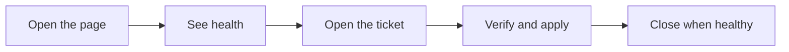

# SRE health checker

## What this is

This is a local health checker. It reads the AWS account in the configured region, shows whether those resources are healthy, and opens a Jira ticket only when there is a real problem the page can act on.

## Run it on your machine

From the repo root, with Python 3.11 or newer, install the package and copy the empty settings template:

```powershell
pip install -e ".[aws]"
Copy-Item config.example.json config.local.json
$env:PYTHONPATH = "src"
```


Populate config as per rwquirement. Secrets stay in that local file or in AWS Secrets Manager (`confluence_secret_arn` and `jira_secret_arn`), not in git.

Start the page, then open http://127.0.0.1:8765/ :

```powershell
python -m sre_agent.demo_ui
```

Each open of the health checker reads the account, including a return from Jira. That read can take a little while. An actionable unhealthy resource gets one Jira ticket. A healthy resource does not leave an open ticket.

Other commands:

- `python -m sre_agent inventory` reads the account and is what creates and updates Jira.
- `python -m sre_agent lab` is simulated and does not change AWS or live Jira.
- `python -m sre_agent mcp` serves that same simulated check over MCP.

If the page says the security token is expired, the AWS CLI login is still valid but the page copied an old session. Stop the page and start it again. If `aws sts get-caller-identity` fails, run `aws login`, then start the page again.

## Walk through the page



### Health checker

Workloads are grouped by type, with a count on each group. Open a type to see name, type, health, problem code, and source. Details shows the account, region, inventory time, and catalog.

### Jira

Jira lists the real open issues in the configured project. Each card has Issue, Where seen, and Proposed solution, and a Take this action button. A ticket is not opened unless that button is on the card. Edit the proposed correction, then Verify and apply. That changes AWS only for a lab queue redrive or restoring the directory Lambda table name, then closes the ticket only after that resource is healthy.

### Confluence

Confluence is read-only cards, one per service. Open a card to see a table of the metric and why it is there. The page does not add or edit Confluence. The section links to the catalog page.

### Mail

Mail is at the bottom of the health checker. Saved addresses are in a dropdown. Add an address to save it. Delete removes the selected address. Mail is sent when a real ticket is created and when a verified action is applied. The page says mail was sent only after the send is accepted. An empty list does not send. The from address is `ses_from_address` in the local file.

## Sample workload

`monitor-labs/working` creates one DynamoDB table, one Lambda that reads it, and one API Gateway that calls that Lambda.

`monitor-labs/break` points that Lambda at a missing table, calls the API, and runs inventory so a Jira ticket with Take this action is opened. Applying working again restores the table name.

```powershell
terraform -chdir=monitor-labs/working init
terraform -chdir=monitor-labs/working apply
terraform -chdir=monitor-labs/break init
terraform -chdir=monitor-labs/break apply
```

Restore the table name with another apply of working:

```powershell
terraform -chdir=monitor-labs/working apply
```
