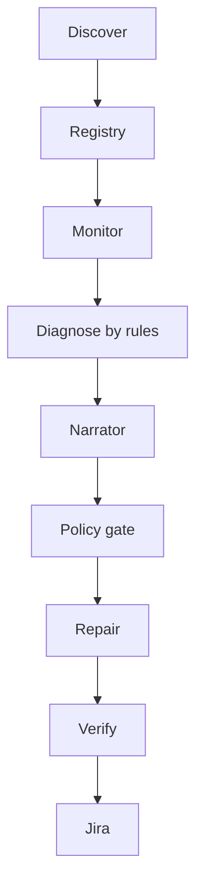
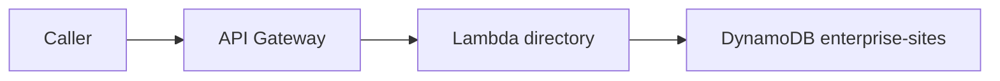

# SRE agent

`sre-agent` watches resources that are already in an AWS account. It discovers them, records a registry, monitors them, diagnoses with rules, explains the result, and stops at the policy gate. A live change runs only for one validated repair, and only on an explicit lab target.

## Commands

Install the package, including boto3 for live AWS calls:

```powershell
pip install -e ".[aws]"
python -m sre_agent demo
python -m sre_agent lab
python -m sre_agent inventory
python -m sre_agent mcp
python -m sre_agent.demo_ui
```

`demo` runs a local scenario in recommend mode and prints a report. `lab` checks `sqs.redrive_dlq` on a local fixture, including the cases where the repair must stay off. Neither command calls the live account.

`inventory` reads the live account. The account and region come from `config.local.json`, or from `--account` and `--region`. The cycle stays in recommend mode and requires approval. Run `aws login` first so the AWS CLI can export a session.

`mcp` serves the same local scenario over MCP on stdio. `sre_repair` ignores any runbook the client sends and runs only a decision the policy gate has already approved.

`python -m sre_agent.demo_ui` serves the demo page at `http://127.0.0.1:8765`.

## Settings

Copy `config.example.json` to `config.local.json`. That file is gitignored. A variable already set in the process environment wins over the file. The account and region in the file are the operator's account and region.

The demo page and its logs redact tokens, keys, and session material. Do not print those values.

Deployed Lambdas use the environment Terraform gives them. `config.local.json` fills names that are still empty on a local run. Jira and Confluence can also be read from a Secrets Manager JSON secret. An environment variable overrides the secret. If only one of `confluence_secret_arn` or `jira_secret_arn` is set, both clients use that secret. A missing base URL, page or project, email, or token leaves that client unset. Discovery runs either way.

## Health-checker cycle



Discovery scans one account and one Region. The built-in collectors are Lambda, SQS, EC2, DynamoDB, and API Gateway. A Confluence heading such as `Service: EKS (eks:cluster)`, or a JSON list at `service_list_uri`, adds further types. Pagination follows continuation tokens. A denied call is recorded and is not treated as an empty result. The caller identity has to match the configured account.

Each resource is stored by account, Region, type, and stable id. A complete scan that does not see a recorded resource marks it uncertain. A direct lookup that returns not found marks it deleted.

Monitoring attaches a pack for the built-in types. A type with no pack stays visible as discovered, with monitoring unsupported. Missing required telemetry is unknown. The Confluence symptom catalog is loaded, versioned, and applied, including metric math and Logs Insights queries. If that load fails, health stays unknown.

Diagnosis is rules. The narrator then explains that result. Gemini is called only when `gemini_enabled` is true and `gemini_api_key` is set, and it receives only the evidence packet. A reply that changes the resource, problem, or action is discarded, and the rule text is kept. With Gemini off, the narrator quotes the rule diagnosis. The narrator has no repair tool.

The policy gate decides next. Recommend mode records the recommendation and does not execute. Verification runs after a repair that was allowed to run. Jira is written when the incident is recorded and updated again after verification.

## Repair

Live defaults are recommend mode, repairs off, and approval required. The only validated repair is `sqs.redrive_dlq`. A live redrive runs only for an explicit lab target: `approval_mode` is `lab`, the target is listed in `lab_targets`, and the executor has repairs enabled. Queue mutations stay limited to those targets. The executor uses its own role and rechecks policy before the mutation. The discovery worker does not assume that role.

Classification for a redrive comes from application logs. Malformed and permanently failing messages stay on the queue. A failing consumer is refused. Recommend mode does not move messages.

## Deploy the checker

`terraform/` deploys the health checker in `us-east-2`: the registry table, the work queue, the repair queue, the worker Lambda, the executor Lambda, and the schedules. Reconciliation is hourly, monitoring is every five minutes, and verification is every minute. Those schedules send work to the worker. The executor reads the repair queue. CloudWatch alarms cover worker errors, executor errors, work-queue age and depth, repair-queue age, repair-queue failures, catalog load, and Jira sync.

`agent_mode` defaults to `recommend`, `repairs_enabled` defaults to false, and `approval_mode` defaults to `required`.

## Site directory

`terraform/lab` is a separate directory. It is the workload the checker watches. Applying `terraform/` does not create it.



API Gateway exposes `GET /sites`, `GET /sites/{siteId}`, and `PUT /sites/{siteId}`. The Lambda reads and writes the DynamoDB table of enterprise sites. The table name defaults to `enterprise-sites`.

## Tear down

From the repo root:

```powershell
powershell -File teardown\down.ps1
powershell -File teardown\down.ps1 -WorkloadOnly
powershell -File teardown\down.ps1 -CheckerOnly
```

`teardown\down.cmd` runs the same script. With no switch, it destroys the site directory from `terraform/lab` state, then the health checker from `terraform` state. `-WorkloadOnly` destroys the site directory. `-CheckerOnly` destroys the health checker. Resources outside those two state files are left in place. A directory with no state file is skipped.

## Demo page

Open `http://127.0.0.1:8765`. Each open reads the live account again. An older scan is not reused.

The inventory lists resources that are present, grouped by AWS type, with a count on each group. The console link is `aws_console_url` from config when that value is set. When it is empty, the page links to the regional console for the configured region.

The page also shows the Confluence symptom catalog, a form to add a service symptom, a Jira board, and a mail box. Break and restore for the directory function stay behind Verify and apply.

## Confluence, Jira, and mail

The Confluence page is the symptom catalog. A service heading plus a symptom table supplies the rules for that type.

Jira project issues use three sections: Issue, Where seen, and Proposed solution. The description heading for the middle section is Where. The demo board labels it Where seen. One open issue is reused for the same problem. The issue type defaults to Task when the secret and the environment omit it. The issue is resolved after verified recovery.

Mail on a new ticket goes only to addresses saved in gitignored `demo_ui/recipients.local.json`. An empty list does not call Amazon SES. The From address is `ses_from_address` in the local config.
