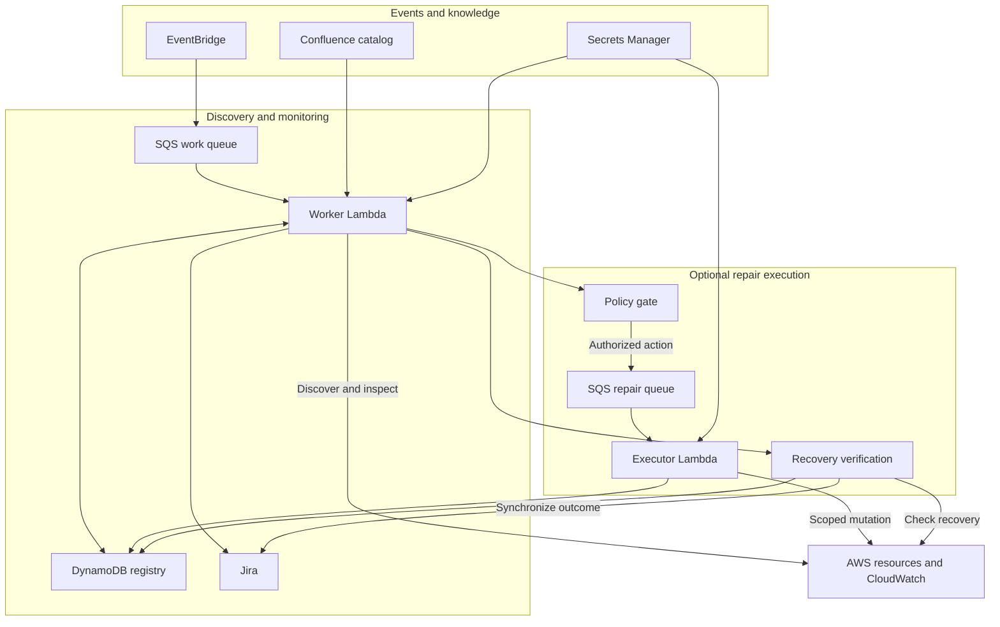
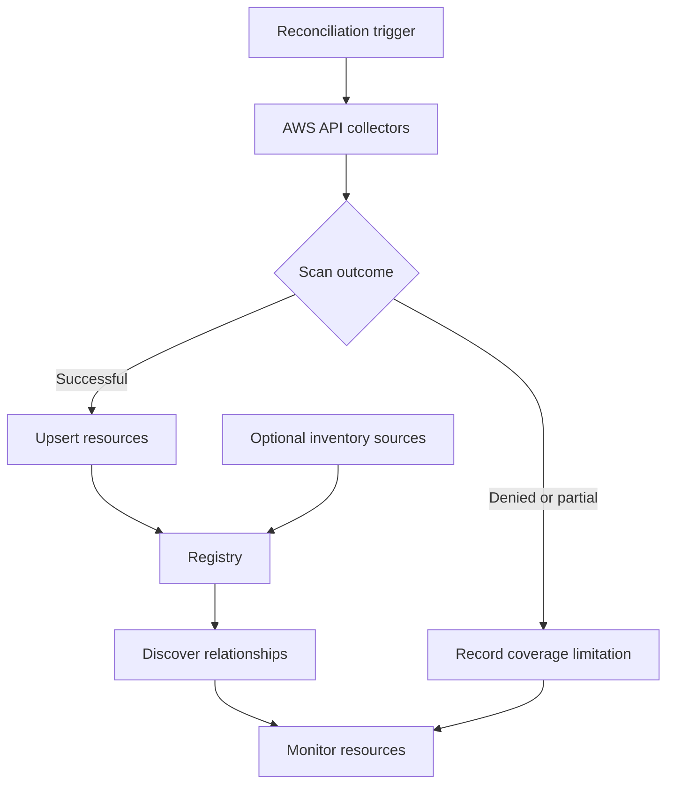
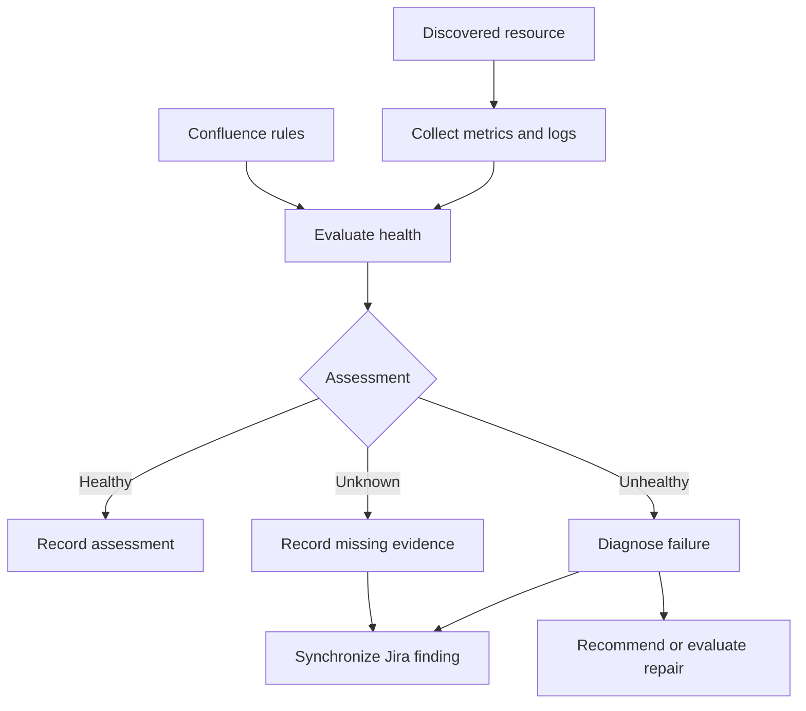
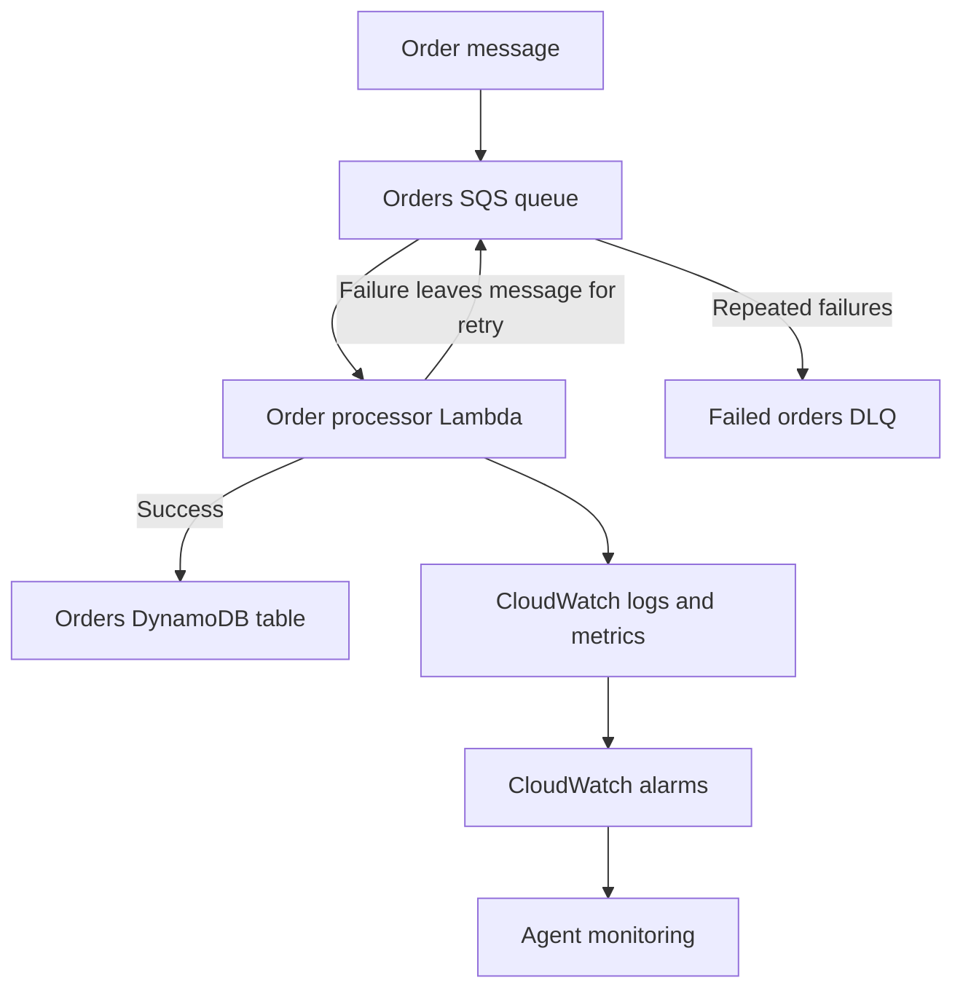
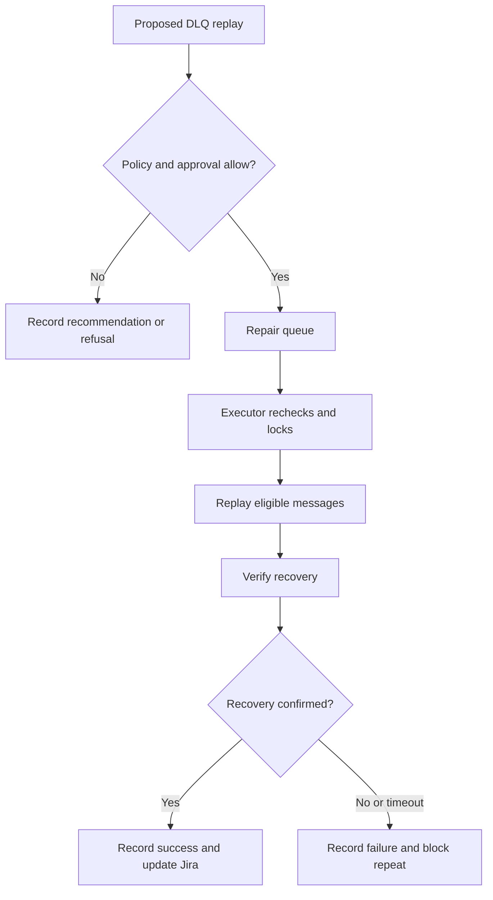

## AWS SRE Tool

An event-driven AWS operations agent that discovers existing resources, maintains a service registry, monitors health, diagnoses failures, and reports findings to Jira.

Confluence provides a versioned failure scenario catalog. Terraform deploys the agent infrastructure.

The agent can discover resources even when they were created without Terraform or a service registry.

## What It Does

- Discovers supported resources in an AWS account and Region.
- Builds a persistent inventory and resource relationship map.
- Collects CloudWatch metrics and application logs.
- Evaluates monitoring rules loaded from Confluence.
- Identifies unhealthy resources and missing telemetry.
- Uses evidence-based rules to diagnose problems.
- Creates and updates Jira Tasks.
- Provides a separate, experimental executor for controlled repairs.
- Records execution and recovery outcomes.

The current demonstrated deployment uses recommendation mode. Detection and reporting are automatic; application recovery is performed manually.

## Architecture



The policy gate and recovery verifier are Python components, not separate deployed services. Scheduled verification runs through the worker.

## Components

| Component | Purpose |
| --- | --- |
| Terraform | Deploys the agent infrastructure and permissions |
| EventBridge | Routes events and schedules discovery, monitoring, and verification |
| Work queue | Buffers operations work for the worker |
| Worker Lambda | Discovers resources, evaluates health, diagnoses findings, and synchronizes Jira |
| DynamoDB registry | Stores resources, relationships, assessments, incidents, actions, and scan history |
| CloudWatch | Provides metrics, logs, alarms, and agent operational visibility |
| Confluence | Supplies the versioned monitoring rule catalog |
| Jira | Records findings and operational outcomes |
| Secrets Manager | Stores Atlassian API tokens |
| Policy gate | Checks whether a proposed repair is permitted |
| Repair queue | Carries repair commands to the executor |
| Executor Lambda | Rechecks conditions and executes supported repair actions |
| Recovery verifier | Checks telemetry and application processing after an action |
| Dead-letter queues | Retain repeatedly failing agent work and repair messages |

Discovery, diagnosis, and execution use separate IAM roles.

## Supported Resource Discovery

The implemented collectors discover:

- Lambda functions
- SQS queues
- EC2 instances
- DynamoDB tables
- API Gateway REST APIs

Optional inventory sources include:

- AWS Config
- AWS Resource Explorer
- Terraform state
- Registration events

These optional sources are not required for direct AWS API discovery.

The deployed worker starts with one configured account and Region. Broader coverage requires additional scope configuration and permissions.

## Discovery Flow



Each resource is identified by its account, Region, type, and stable identity.

Collectors handle API pagination. A denied or incomplete scan is recorded as a coverage limitation rather than interpreted as an empty account.

A resource missing from a successful list becomes uncertain. A direct lookup confirming that it no longer exists is needed before marking it deleted.

Terraform state can provide ownership and intended configuration, but it is not a complete service registry.

## Monitoring and Diagnosis

The agent reads resource configuration, metrics, logs, and relationship evidence.

Health assessments distinguish:

| State | Meaning |
| --- | --- |
| Healthy | Available evidence satisfies the applicable checks |
| Unhealthy | Available evidence shows a problem |
| Unknown | Required evidence is missing, stale, unavailable, or denied |

Missing telemetry is not treated as healthy.



Diagnosis uses deterministic rules and read-only evidence. The deployed system does not require an LLM or Amazon Bedrock.

Resource relationships help avoid inappropriate actions. For example, a queue backlog caused by a failing consumer should not automatically trigger message replay.

## Confluence Integration

Confluence acts as the monitoring knowledge source.

The agent:

1. Authenticates using the configured Atlassian email and API token.
2. Retrieves the configured page.
3. Parses and validates its monitoring rule table.
4. Records the catalog version and rule count.
5. Evaluates applicable rules against AWS telemetry.

The table requires these exact columns:

| Column | Purpose |
| --- | --- |
| `resource_type` | AWS resource type |
| `signal` | Metric or supported signal |
| `statistic` | Aggregation used to evaluate the signal |
| `comparison` | Threshold comparison |
| `threshold` | Trigger value |

Optional columns include `rule_id`, `period_seconds`, `expression`, and `log_query`.

Example:

| rule_id | resource_type | signal | statistic | comparison | threshold | period_seconds |
| --- | --- | --- | --- | --- | --- | --- |
| lambda-errors | lambda:function | Errors | Sum | GreaterThanOrEqualToThreshold | 1 | 60 |
| queue-age | sqs:queue | ApproximateAgeOfOldestMessage | Maximum | GreaterThanThreshold | 120 | 60 |

Rules match resource types. The example queue rule is not restricted to a particular queue name.

If the catalog cannot be loaded, catalog-dependent checks remain unknown.

Confluence supplies monitoring rules; it does not authorize arbitrary AWS changes.

## Jira Integration

The agent creates or updates Jira Tasks containing its findings.

Configuration includes:

- Atlassian site URL
- Project key
- Account email
- API token secret ARN
- Issue type
- Recovery transition

The demonstrated project uses:

```text
Project key: KAN
Issue type: Task
```

An open incident is reused for the same account, Region, resource, and problem type.

The current implementation can also report healthy or unknown assessments. A Task's existence alone does not prove a failure occurred: inspect its description and affected resource.

Verified recovery is required by the repair workflow before its completion transition. Manual restoration in the recommendation demo should not be presented as automatic ticket closure.

## Test Application Architecture

The demonstrated workload is a separate orders application.



The processor:

- Validates the order.
- Writes the processed order to DynamoDB.
- Uses a conditional write to skip duplicate insertion.
- Records the processing timestamp and message identifiers.
- Logs processing and failure events.

The environment variable below introduces a temporary consumer failure:

```text
SIMULATE_CONSUMER_FAILURE=true
```

Restoring it to `false` allows future processing to succeed.

Messages containing `simulate_failure=true` exercise a separate permanent-failure scenario.

The live orders application is maintained in its own Terraform directory and state. The repository's `terraform/lab/` contains a smaller payments workload; it is not the same orders application.

## Repository Structure

```text
src/sre_agent/
  aws/                 AWS readers, pagination, and simulated adapters
  discovery/           Resource collectors and discovery scope
  registry/            Persistence and record encoding
  monitoring/          Monitoring packs and catalog evaluation
  diagnosis/           Diagnosis rules and evidence tools
  policy/              Repair policy and approval checks
  executor/            Repair runbooks
  verification/        Recovery checks
  integrations/        Jira, Confluence, and secret loading
  lessons/             Failed-recovery history
  lab/                 Simulated fault scenarios
  worker.py            Operations Lambda handler
  executor_worker.py   Repair Lambda handler
  cli.py               Local commands

terraform/
  main.tf              Agent infrastructure
  variables.tf         Deployment configuration
  lab/                 Separate payments workload

tests/                 Automated tests
```

## Prerequisites

- Python 3.11 or later
- Terraform compatible with the repository configuration
- AWS CLI with an authenticated profile
- An AWS account with permission to deploy the required services
- A Confluence catalog page
- A Jira project
- Atlassian API credentials with access to those resources

The current default AWS Region is `us-east-2`.

Organizational policies can restrict deployment even when the signed-in role has broad IAM permissions.

## Run Locally

Clone the repository:

```bash
git clone https://github.com/shrutiebony/AWS_SRE_Tool.git
cd AWS_SRE_Tool
```

Create a virtual environment:

```bash
python -m venv .venv
```

Activate it on Windows CMD:

```cmd
.venv\Scripts\activate
```

Or on Linux/macOS:

```bash
source .venv/bin/activate
```

Install dependencies:

```bash
python -m pip install -e ".[aws]" pytest
```

Run tests:

```bash
python -m pytest
```

Run the simulated recommendation demo:

```bash
python -m sre_agent demo
```

Run simulated repair scenarios:

```bash
python -m sre_agent lab
```

The local `demo` and `lab` commands use simulated resources. They do not deploy or repair live AWS infrastructure.

## Run a Live Inventory

Verify authentication:

```bash
aws sts get-caller-identity
```

Run discovery:

```bash
python -m sre_agent inventory --account YOUR_ACCOUNT_ID --region us-east-2
```

This command remains in recommendation mode.

Local integration configuration uses the same relevant environment variables as the worker, including:

```text
CONFLUENCE_BASE_URL
CONFLUENCE_PAGE_ID
CONFLUENCE_EMAIL
CONFLUENCE_TOKEN or CONFLUENCE_SECRET_ARN

JIRA_BASE_URL
JIRA_PROJECT
JIRA_EMAIL
JIRA_TOKEN or JIRA_SECRET_ARN

SRE_REGISTRY_TABLE
SRE_ORDER_TABLE
```

## Configure Atlassian Credentials

Store the API token in AWS Secrets Manager:

```json
{
  "token": "YOUR_ATLASSIAN_API_TOKEN"
}
```

Pass the secret ARN to Terraform.

The client uses email-and-token Basic authentication against the configured Atlassian site. Use a token compatible with that authentication route.

One secret can serve both integrations if the account has access to both Jira and Confluence. Separate secrets are also supported.

Do not commit API tokens, credentials, or Terraform state to Git.

## Terraform Configuration

Create `terraform/terraform.tfvars`.

Replace the example account, URLs, email, page ID, and secret ARNs:

```hcl
aws_region        = "us-east-2"
name_prefix       = "sre-agent"
agent_mode        = "recommend"
repairs_enabled   = false
approval_mode     = "required"
enable_cloudtrail = false

confluence_base_url   = "https://YOUR_SITE.atlassian.net"
confluence_page_id    = "YOUR_PAGE_ID"
confluence_email      = "YOUR_ATLASSIAN_EMAIL"
confluence_secret_arn = "arn:aws:secretsmanager:us-east-2:123456789012:secret:YOUR_SECRET"

jira_base_url   = "https://YOUR_SITE.atlassian.net"
jira_project    = "KAN"
jira_email      = "YOUR_ATLASSIAN_EMAIL"
jira_issue_type = "Task"
jira_secret_arn = "arn:aws:secretsmanager:us-east-2:123456789012:secret:YOUR_SECRET"

order_table_name = "agent-lab-orders"
order_table_arn  = "arn:aws:dynamodb:us-east-2:123456789012:table/agent-lab-orders"

lab_queue_arns = [
  "arn:aws:sqs:us-east-2:123456789012:agent-lab-orders",
  "arn:aws:sqs:us-east-2:123456789012:agent-lab-failed-orders"
]
```

Order-table configuration is optional unless using the orders recovery checks.

Providing lab queue ARNs scopes executor permissions. It does not enable automatic repairs.

Override the repository's demo-specific Atlassian defaults for your own environment.

## Deploy with Terraform

From the agent's Terraform directory:

```bash
cd terraform
terraform init
terraform fmt
terraform validate
terraform plan -out=agent.tfplan
terraform apply agent.tfplan
```

Review the plan before applying.

Terraform packages the Python source and creates the configured infrastructure, including:

- Worker and executor Lambda functions
- DynamoDB registry
- Work and repair queues
- Dead-letter queues
- IAM roles and policies
- EventBridge rules and targets
- Operational CloudWatch alarms

Keep application infrastructure and agent infrastructure in separate Terraform states.

For an existing deployment, update it from its original directory and state.

## Scheduled Operation

| Trigger | Default schedule or source |
| --- | --- |
| Reconciliation | Hourly |
| Monitoring | Every five minutes |
| Recovery verification | Every minute |
| Alarm processing | Matching CloudWatch alarm events |
| Resource change processing | Matching CloudTrail management events when available |

With `enable_cloudtrail=false`, scheduled discovery and CloudWatch alarm events still work.

Creating an EventBridge CloudTrail rule does not itself create a trail or guarantee management-event coverage.

## Verify Deployment

Invoke the worker:

```bash
aws lambda invoke --function-name sre-agent-worker --payload "{}" --region us-east-2 discovery-result.json
```

Inspect the response file:

```json
{
  "handled": ["reconcile"]
}
```

Review logs:

```bash
aws logs tail /aws/lambda/sre-agent-worker --since 10m --region us-east-2
```

Inspect scan records:

```bash
aws dynamodb scan --table-name sre-agent-registry --region us-east-2 --query "Items[?collection.S=='scans'].doc.S" --output json
```

Check for:

- Successful supported-resource scans
- Successful Confluence loading
- A catalog version and nonzero rule count
- Jira findings matching the monitored resources

A successful Lambda invocation does not prove that every integration succeeded.

Registry item count includes operational records and should not be interpreted as the number of discovered services.

For console-only verification, open `sre-agent-worker` in Lambda and run a test event containing `{}`.

## End-to-End Console Demo

Use the deployed orders application and select Ohio, `us-east-2`, in the AWS Console.

1. Show the Confluence failure scenario catalog.
2. Open `agent-lab-order-processor` in Lambda.
3. Under Configuration → Environment variables, set `SIMULATE_CONSUMER_FAILURE` to `true`. Preserve `TABLE_NAME`.
4. Open `agent-lab-orders` in SQS and send:

```json
{
  "order_id": "video-demo-001",
  "item": "keyboard"
}
```

5. Show the Lambda logs containing `transient_failure` and `Intentional temporary consumer failure`.
6. Show the `agent-lab-processor-errors` CloudWatch alarm.
7. Allow monitoring to run, then show the Jira Task reporting Lambda errors.
8. Confirm the Task's affected resource is the order processor.
9. Restore `SIMULATE_CONSUMER_FAILURE` to `false`.
10. Send a fresh recovery order:

```json
{
  "order_id": "video-recovery-001",
  "item": "mouse"
}
```

11. Open the orders table in DynamoDB and show the recovery order with `status=processed`.

Use fresh order IDs for repeated demonstrations.

Console changes create Terraform drift until restored or reconciled. Earlier failed orders may already be in the DLQ; successful processing of a fresh order does not prove those orders were replayed.

This demo demonstrates automatic discovery, monitoring, Confluence integration, Jira reporting, and manual recovery.

## Experimental Automatic Repairs

The implemented repair runbook is:

```text
sqs.redrive_dlq
```

Its intended purpose is replaying eligible transient orders after the consumer is healthy.



Relevant controls include:

- `agent_mode`
- `repairs_enabled`
- `approval_mode`
- `lab_targets`
- `approver_account_ids`

Required approval checks use the Jira comment author's Atlassian account ID against an explicit allow list.

The repair does not fix Lambda code, rewrite invalid orders, or authorize arbitrary infrastructure changes.

Automatic repairs remain experimental. Pending review areas include DLQ sampling permissions, reliable command handling, idempotency, approval and locking edge cases, execution bookkeeping, and recovery timing.

Keep repairs disabled for the documented recommendation demo.

## Demonstrated Results

The current AWS demonstration has shown:

- Successful Terraform deployment
- Discovery of 11 supported resources
- Loading of Confluence catalog version 2 with 21 rules
- Intentional Lambda consumer failure
- CloudWatch alarm activation
- Jira reporting of Lambda errors with a 100% error rate

The reviewed project passed 62 local automated tests. Local tests do not establish live automatic-repair readiness.

## Troubleshooting

| Problem | Check |
| --- | --- |
| AWS credentials missing | Authenticate and verify caller identity |
| Explicit service control policy deny | Check organization restrictions and permitted Regions |
| Integration edits produce no Terraform changes | Confirm you edited the agent directory rather than the application lab |
| Confluence loading fails | Check page access, credentials, secret permissions, and table headers |
| Jira creation fails | Check project key, issue type, credentials, and project permissions |
| Health remains unknown | Inspect metric freshness, scan coverage, permissions, and applicable rules |
| Alarm appears but Jira does not update | Inspect worker execution, scheduled monitoring, queues, and synchronization results |
| Failed orders remain after restoration | Recommendation mode does not replay DLQ messages |

## Limitations

- Discovery covers implemented collectors, not every AWS service.
- Global services are not included in the default regional discovery scope.
- Multi-account operation requires explicit configuration.
- Missing telemetry can create unknown-health findings.
- Jira findings may include healthy and unknown assessments.
- Automatic repairs require further end-to-end validation.
- The current live demo does not demonstrate automatic repair or automatic ticket closure.

## Cleanup

Restore demo fault switches before cleanup.

From each Terraform deployment directory:

```bash
terraform plan -destroy
terraform destroy
```

Review the resources before confirming.

The agent and application lab require separate cleanup operations. Destroying the application may delete its queues and orders table.
